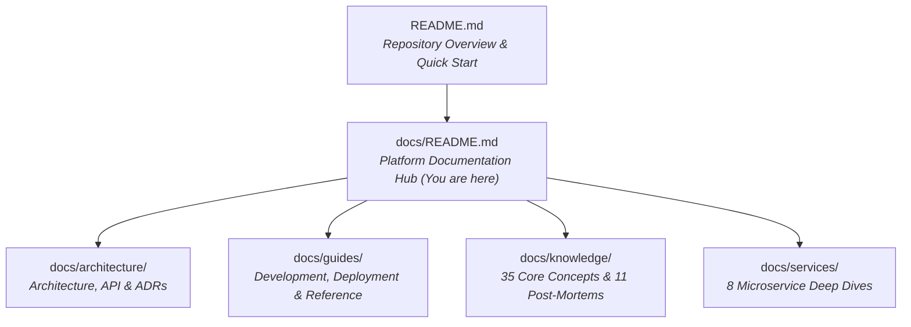

# Platform Documentation Hub

Welcome to the **Data Enrichment AI Intelligence Platform** documentation hub.

This directory is the single authoritative home for all platform specifications: system architecture, API contracts, microservice implementation guides, development standards, container deployment topologies, architectural decisions, and senior engineering reference catalogs.

---

## 1. Documentation Architecture

---

## 2. Platform Architecture & Design (`architecture/`)

| Document | Core Focus Areas |
| :--- | :--- |
| **[System Architecture](architecture/architecture.md)** | Multi-service topology, port assignments, synchronous `RestClient` orchestration, dynamic Eureka discovery, distributed MDC tracing, and 6-stage dataset enrichment sequence. |
| **[API Specifications & Contracts](architecture/api.md)** | Ingress routing table, HMAC-SHA256 JWT validation, anti-spoofing header normalization, RFC 7807 error schema, DTO boundary rules, and full endpoints catalog. |
| **[Architecture Decisions (ADRs)](architecture/decisions.md)** | ADRs 01 through 09 (boundary decomposition, verbatim quote grounding, deterministic fallbacks, bounded concurrency, SSE streaming, MySQL schema, DTO segregation) and platform timeline. |

---

## 3. Operational Guides & Standards (`guides/`)

| Document | Core Focus Areas |
| :--- | :--- |
| **[Development & Engineering Standards](guides/development.md)** | Local development prerequisites (JDK 25, Node 22), simplified 5-package and 4-package architectures, Lombok + Java 25 preview constructor guardrails, and JUnit 5 test suites. |
| **[Deployment & Infrastructure Guide](guides/deployment.md)** | Docker Compose topologies (`dev-all`, `dev`, `prod`), watch hot-reloading, anonymous volume shadowing, GCP Compute Engine VM provisioning, firewall rules, and CI/CD. |
| **[Configuration & Glossary](guides/reference.md)** | Consolidated environment variables matrix, Spring Boot application property keys across all services, and domain glossary (Confidence Tiers, Delimiter Sniffing, Evidence Tuples). |

---

## 4. Microservice Deep Dives (`services/`)

Comprehensive, self-contained implementation guides for each independently deployable microservice:

### Core Business Services
* **[Dataset Service](services/dataset-service.md)** (`:9743`): Ingestion, tabular parsing, schema profiling, bounded async batch workers (`EnrichmentTaskExecutor`), GoF Bridge pattern for real-time SSE streaming, and MySQL relational persistence.
* **[Research Service](services/research-service.md)** (`:9741`): Contextual `QueryBuilder`, Tavily/Mock search providers, defensive web crawler, SSRF protection, specialized field extractors, and multi-source corroboration engine (`EvidenceMerger`).
* **[AI Intelligent Service](services/ai-intelligent-service.md)** (`:9742`): Spring AI Gemini Flash integration, zero-hallucination verbatim quote verification guard, prompt templating, error classification, and transparent deterministic heuristic fallback.

### Platform Infrastructure & Client
* **[API Gateway](services/api-gateway.md)** (`:9738` / `:8080`): Spring Cloud Gateway reverse proxy, JWT validation, anti-spoofing header normalization, CORS, and security headers.
* **[Auth Service](services/auth-service.md)** (`:9739`): User registration, BCrypt credential hashing, Flyway `users` schema, and signed HMAC-SHA256 JWT lifecycle.
* **[Config Server](services/config-server.md)** (`:9736`): Spring Cloud Config Server native search profile and local YAML fallback semantics.
* **[Discovery Server](services/discovery-server.md)** (`:9737`): Spring Cloud Netflix Eureka service registry, heartbeat tuning, and instance health tracking.
* **[Frontend Application](services/frontend.md)** (`:3000`): Next.js 15, in-browser SheetJS parsing, live SSE execution dashboard with active worker cards, and non-destructive spreadsheet export.

---

## 5. Senior Engineering Knowledge Base (`knowledge/`)

* **[35 Core Engineering & AI Concepts](knowledge/concepts.md)**: An exhaustive 1,300+ line reference analyzing 35 design patterns, concurrency primitives, and applied GenAI grounding architectures implemented across the codebase.
* **[Production Failure Modes & Post-Mortems Archive](knowledge/failure-modes.md)**: 11 real production post-mortems documenting root-cause analysis, reproduction logs, code remediation, and regression test guards.
