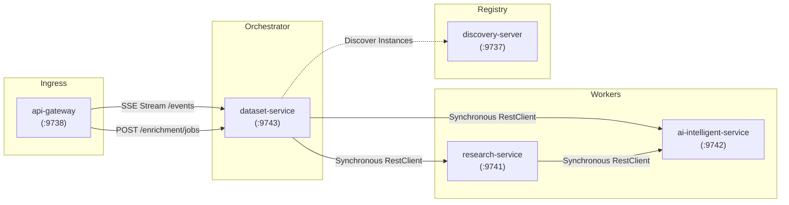
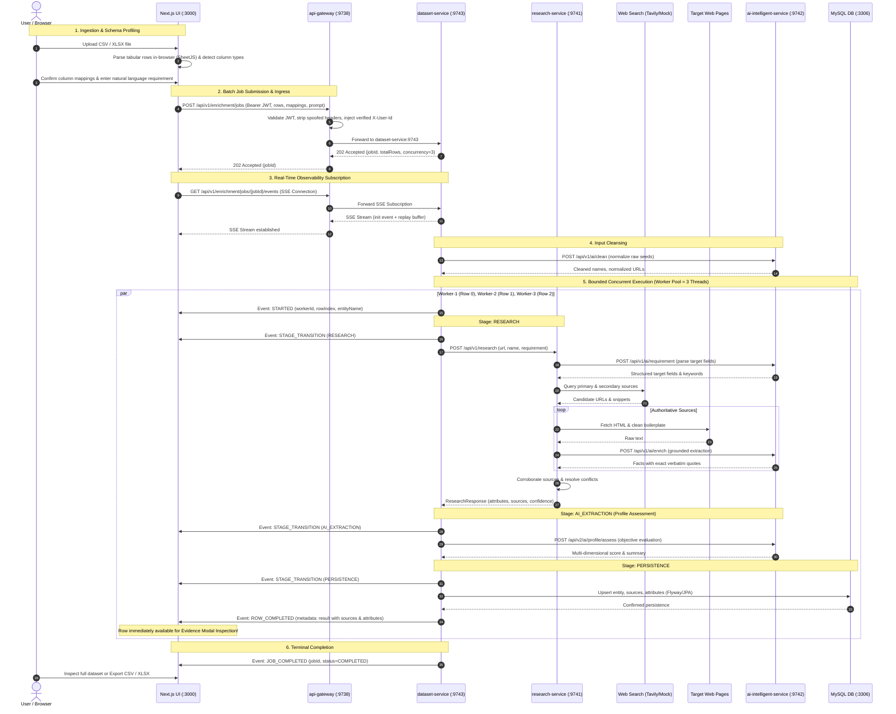

# System Architecture & Technical Flow

The **Data Enrichment AI Intelligence Platform** is a distributed, production-grade enrichment engine that transforms sparse, noisy, or unstructured entity inputs into verified, structured, requirement-aware profiles backed by verbatim evidence quotes and multi-source confidence tiers.

---

## Table of Contents
- [1. High-Level Topology & Ingress Architecture](#1-high-level-topology--ingress-architecture)
- [2. Microservice Topology & Port Matrix](#2-microservice-topology--port-matrix)
- [3. Inter-Service Communication via RestClient](#3-inter-service-communication-via-restclient)
- [4. Distributed Tracing & MDC Correlation](#4-distributed-tracing--mdc-correlation)
- [5. End-to-End Dataset Enrichment Flow](#5-end-to-end-dataset-enrichment-flow)
- [6. Core Architectural Invariants](#6-core-architectural-invariants)

---

## 1. High-Level Topology & Ingress Architecture

The platform isolates web volatility, external AI reasoning, and relational database persistence across dedicated Spring Boot microservices inside a secure Docker bridge network:

```mermaid
flowchart TB
    subgraph External ["External Clients & Browsers"]
        Browser["User Browser / Client Application"]
    end

    subgraph HostPorts ["Exposed Host Ports (Public Ingress)"]
        Port3000["Port 3000: Web Dashboard"]
        Port9738["Port 9738: API Gateway Ingress"]
    end

    subgraph InternalNet ["Isolated Internal Network (enrichment-network)"]
        subgraph Infra ["Platform Infrastructure Layer"]
            ConfigServer["config-server (:9736)<br/>- Spring Cloud Config Server (native)<br/>- Centralized YAML in /config"]
            DiscoveryServer["discovery-server (:9737)<br/>- Spring Cloud Netflix Eureka<br/>- Dynamic Heartbeats & Registry"]
            ApiGateway["api-gateway (:9738)<br/>- Spring Cloud Gateway (WebMvc)<br/>- Unified Reverse Proxy & Routing<br/>- JWT Bearer Auth & Anti-Spoofing"]
        end

        subgraph Backend ["Microservices Layer (Spring Boot 4 / Java 25)"]
            AuthService["auth-service (:9739)<br/>- User Registration & Login<br/>- BCrypt Password Hashing<br/>- HMAC-SHA256 JWT Issuance"]
            DatasetService["dataset-service (:9743)<br/>- Batch Enrichment Jobs<br/>- Bounded Concurrency (3 Workers)<br/>- Real-Time SSE Stream (:events)<br/>- MySQL Relational Persistence"]
            ResearchService["research-service (:9741)<br/>- Entity Identity & Normalization<br/>- Requirement-Aware Search Queries<br/>- Multi-Source Web Discovery<br/>- Polite Fetching & Cleaning<br/>- Multi-Source Corroboration"]
            AIService["ai-intelligent-service (:9742)<br/>- Spring AI (Google GenAI Gemini Client)<br/>- Input Data Cleansing<br/>- Grounded Fact Extraction<br/>- Zero-Hallucination Guardrails<br/>- Deterministic Fallback Engine"]
        end

        subgraph Storage ["Persistence Layer (Internal Port 3306)"]
            MySQL[("MySQL 8.0+<br/>- users<br/>- entities (user_id)<br/>- entity_sources<br/>- entity_attributes<br/>- flyway_schema_history")]
        end
    end

    subgraph CloudAPIs ["External Cloud Providers"]
        SearchAPI["Web Search Engine<br/>(Tavily / Mock Provider)"]
        WebPages["Discovered Web Pages / URLs"]
        LLMProvider["LLM API<br/>(Google Gemini / Vertex)"]
    end

    Browser -->|Port 3000| Port3000
    Browser -->|Port 9738 (REST / SSE)| Port9738
    Port9738 --> ApiGateway

    ApiGateway -->|/api/v1/auth/**| AuthService
    ApiGateway -->|/api/v1/enrichment/**| DatasetService
    ApiGateway -->|/api/v1/entities/**| DatasetService
    ApiGateway -->|/api/v2/datasets/**| DatasetService
    ApiGateway -->|/api/v1/research/**| ResearchService
    ApiGateway -->|/api/v1/ai/**| AIService
    ApiGateway -->|/api/v2/ai/**| AIService

    Backend -.->|Config Fetch| ConfigServer
    Backend -.->|Heartbeat & Discovery| DiscoveryServer
    ApiGateway -.->|Heartbeat & Discovery| DiscoveryServer

    ResearchService --> SearchAPI
    ResearchService --> WebPages
    AIService --> LLMProvider
    DatasetService --> MySQL
    AuthService --> MySQL
```

---

## 2. Microservice Topology & Port Matrix

| Service | Host Port | Internal Port | Technology Stack | Primary Bounded Context |
| :--- | :--- | :--- | :--- | :--- |
| **`frontend`** | `3000` | `3000` | Next.js 15, React 19, Tailwind CSS, SheetJS | Interactive dashboard, schema profiling, real-time SSE execution, non-destructive export. |
| **`api-gateway`** | `9738` (or `8080`) | `9738` | Spring Cloud Gateway (WebMvc) | Unified ingress reverse proxy, JWT validation, anti-spoofing header normalization, CORS. |
| **`config-server`** | None | `9736` | Spring Cloud Config Server | Native file-based configuration provider with embedded fallback. |
| **`discovery-server`** | None | `9737` | Spring Cloud Netflix Eureka | Dynamic service registry, instance health monitoring, and heartbeat leases. |
| **`auth-service`** | None | `9739` | Spring Boot 4, Spring Security, BCrypt, JJWT | User authentication, token issuance, and credential management. |
| **`research-service`** | None | `9741` | Spring Boot 4, Jsoup, Tavily API | Multi-query discovery, defensive scraping, SSRF protection, corroboration engine. |
| **`ai-intelligent-service`** | None | `9742` | Spring Boot 4, Spring AI, Gemini | LLM extraction, verbatim quote verification, deterministic heuristic fallbacks. |
| **`dataset-service`** | None | `9743` | Spring Boot 4, Spring Data JPA, Flyway, MySQL | Batch orchestration, worker concurrency (`EnrichmentTaskExecutor`), SSE streaming, snapshot persistence. |
| **`mysql`** | None (Dev: `3306`) | `3306` | MySQL 8.0 Community Edition | ACID relational storage for users, entities, sources, and attributes. |

---

## 3. Inter-Service Communication via `RestClient`

Spring 6's modern, fluent, synchronous `RestClient` is used exclusively for internal HTTP calls across all microservices:



* **Client Configuration**: Every `RestClient` registers a custom `CorrelationIdClientInterceptor` ensuring distributed correlation propagation.
* **Dual Resolution**: Supports Eureka logical discovery (`lb://RESEARCH-SERVICE`) and direct container networking (`http://research-service:9741`).
* **Timeout Hierarchies**: Research calls allow up to 45 seconds for multi-source web crawling; AI extraction calls are strictly bounded to 15 seconds.

---

## 4. Distributed Tracing & MDC Correlation

Every request traversing the platform is bound to an MDC (Mapped Diagnostic Context) trace:
* **Header**: `X-Correlation-ID`
* **Gateway Role**: Generates a UUID v4 if omitted and injects it into downstream request headers.
* **Downstream Propagation**: Filter extracts `X-Correlation-ID` on ingress; interceptor attaches it on egress.
* **Log Pattern**: Every log statement includes `[corrId=<uuid>]` enabling end-to-end tracing across service log files.

---

## 5. End-to-End Dataset Enrichment Flow



---

## 6. Core Architectural Invariants

1. **Separation of Volatility**: Web crawling and LLM prompting are non-deterministic, high-latency, and failure-prone. Database transactions, user authentication, and API routing are isolated in separate processes so network instability never compromises persistence.
2. **Zero-Hallucination Principle**: LLM-extracted claims are admitted into the platform only if accompanied by an exact verbatim quote verified against the scraped source text (`sourceText.contains(exactQuote)`). Missing evidence yields `UNKNOWN`, never a plausible hallucination.
3. **Bounded Concurrency**: Thread pools are strictly bounded (`EnrichmentTaskExecutor`: 3 workers, 500-capacity queue, `CallerRunsPolicy` backpressure) to prevent thread starvation and third-party rate-limiting.
4. **Idempotent Snapshot Persistence**: Entity snapshots use JPA orphan removal (`orphanRemoval = true`). Re-running an enrichment job replaces obsolete sources and attributes without leaving orphan records.
5. **Non-Destructive Export**: Exports strictly preserve all original columns and ordering, appending newly discovered attributes with an `Enriched_` prefix.
