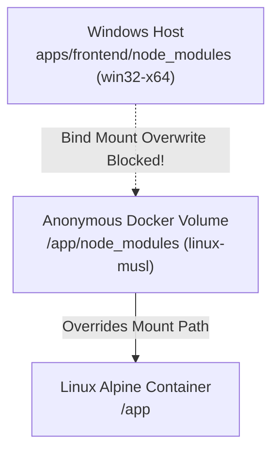

# Deployment & Infrastructure Guide

This guide details the Docker Compose container topologies, live development hot-reloading mechanics, bridge network security, Google Cloud Platform (GCP) Compute Engine virtual machine provisioning, and automated GitHub Actions CI/CD pipelines.

---

## Table of Contents
- [1. Docker Compose Topologies](#1-docker-compose-topologies)
  - [1.1 Full Development Stack (docker-compose-dev-all.yml)](#11-full-development-stack-docker-compose-dev-allyml)
  - [1.2 Infrastructure-Only Stack (docker-compose-dev.yml)](#12-infrastructure-only-stack-docker-compose-devyml)
  - [1.3 Hardened Production Stack (docker-compose.prod.yml)](#13-hardened-production-stack-docker-composeprodyml)
- [2. Hot-Reloading & Volume Shadowing](#2-hot-reloading--volume-shadowing)
- [3. GCP VM Production Provisioning](#3-gcp-vm-production-provisioning)
  - [Step 1: Compute Engine Instance](#step-1-compute-engine-instance)
  - [Step 2: VPC Firewall Rules](#step-2-vpc-firewall-rules)
  - [Step 3: Docker & Host Hardening (Swapfile)](#step-3-docker--host-hardening-swapfile)
- [4. Automated GitHub Actions CI/CD Pipeline](#4-automated-github-actions-cicd-pipeline)
- [5. Operations, Diagnostics & Rollback](#5-operations-diagnostics--rollback)

---

## 1. Docker Compose Topologies

All container orchestrations reside in `infrastructure/docker/`:

| Compose File | Target Environment | Active Services | Host Port Mappings |
| :--- | :--- | :--- | :--- |
| **`docker-compose-dev-all.yml`** | Full local development with live code sync | Frontend, Research, AI, Dataset, MySQL | All service ports mapped |
| **`docker-compose-dev.yml`** | Infrastructure-only for IDE microservice runs | MySQL 8.0 only | Port 3306 mapped |
| **`docker-compose.prod.yml`** | Hardened production deployment | 7 microservices + Frontend + MySQL | Ports 3000 & 9738 only |

### 1.1 Full Development Stack (`docker-compose-dev-all.yml`)
Runs the full multi-service stack with **Docker Compose Watch** (`develop.watch`) for instant hot-reloading:
```bash
docker compose -f infrastructure/docker/docker-compose-dev-all.yml up -d --build
```

### 1.2 Infrastructure-Only Stack (`docker-compose-dev.yml`)
For developers running Spring Boot microservices and Next.js directly inside an IDE (IntelliJ, VS Code):
```bash
docker compose -f infrastructure/docker/docker-compose-dev.yml up -d
# MySQL will be available on localhost:3306
```

### 1.3 Hardened Production Stack (`docker-compose.prod.yml`)
In production, external clients (browsers) communicate exclusively with two public entrypoints: **Frontend UI (`:3000`)** and **API Gateway (`:9738`)**. All 7 backend microservices and MySQL run inside an isolated Docker bridge network (`enrichment-network`) without exposing host ports.

---

## 2. Hot-Reloading & Volume Shadowing

### The Host vs. Container Node Modules Trap
When developing a Next.js frontend with Docker on a Windows host:
1. The host machine runs Windows x64 with Windows native modules in `apps/frontend/node_modules` (e.g. `@next/swc-win32-x64-msvc`).
2. The Docker container runs Linux Alpine (`node:22-alpine`) requiring Linux-compiled native binaries (`@next/swc-linux-x64-musl`).
3. If host `apps/frontend` is naively bind-mounted directly to container `/app`, the Windows `node_modules` overwrite the Linux container `node_modules`, causing instant crashes (`cannot find module @next/swc-linux-x64-musl`).



### Anonymous Volume Shadowing Solution
In `infrastructure/docker/docker-compose-dev-all.yml`:
```yaml
volumes:
  - ../../apps/frontend:/app         # Host source code bind mount
  - /app/node_modules                # Shadowing: preserves container Linux node_modules
  - /app/.next                       # Shadowing: isolates container Turbopack build cache
```
By declaring `/app/node_modules` and `/app/.next` as anonymous volumes, Docker Compose ensures container-internal Linux builds take precedence over host filesystem contents while still synchronizing `.tsx` code changes instantaneously.

---

## 3. GCP VM Production Provisioning

### Step 1: Compute Engine Instance
Recommended Sizing: `e2-standard-4` (4 vCPUs, 16 GB RAM), Ubuntu 24.04 LTS, 50 GB SSD (`pd-balanced`):

```bash
gcloud compute instances create enrichment-platform-vm \
    --project="<YOUR_GCP_PROJECT_ID>" \
    --zone="us-central1-a" \
    --machine-type="e2-standard-4" \
    --tags="enrichment-platform,http-server,https-server" \
    --create-disk="auto-delete=yes,boot=yes,image=projects/ubuntu-os-cloud/global/images/family/ubuntu-2404-lts-amd64,size=50,type=pd-balanced"
```

### Step 2: VPC Firewall Rules
Strictly restrict ingress traffic to SSH, Frontend, and Gateway:

```bash
# Allow SSH (Port 22)
gcloud compute firewall-rules create allow-enrichment-ssh \
    --direction=INGRESS --priority=1000 --action=ALLOW --rules=tcp:22 --source-ranges=0.0.0.0/0 --target-tags=enrichment-platform

# Allow Frontend UI (Port 3000)
gcloud compute firewall-rules create allow-enrichment-frontend \
    --direction=INGRESS --priority=1000 --action=ALLOW --rules=tcp:3000 --source-ranges=0.0.0.0/0 --target-tags=enrichment-platform

# Allow API Gateway Ingress (Port 9738)
gcloud compute firewall-rules create allow-enrichment-gateway \
    --direction=INGRESS --priority=1000 --action=ALLOW --rules=tcp:9738 --source-ranges=0.0.0.0/0 --target-tags=enrichment-platform
```

### Step 3: Docker & Host Hardening (Swapfile)
Configure a 4 GB swapfile to prevent Linux OOM-killer from terminating JVM processes during concurrent batch bursts:

```bash
sudo fallocate -l 4G /swapfile
sudo chmod 600 /swapfile
sudo mkswap /swapfile
sudo swapon /swapfile
echo '/swapfile none swap sw 0 0' | sudo tee -a /etc/fstab
```

---

## 4. Automated GitHub Actions CI/CD Pipeline

The repository includes a GitHub Actions workflow (`.github/workflows/deploy.yml`):
1. **Trigger**: Push to `main` branch.
2. **Build & Push**: Builds production Docker images and publishes them to Google Artifact Registry (GAR).
3. **SSH Deployment**: Securely logs into the GCP VM via SSH key, pulls new images, runs Flyway migrations, and reloads the stack using `docker compose -f docker-compose.prod.yml up -d --remove-orphans`.
4. **Healthcheck Probe**: Probes `http://localhost:9738/actuator/health` and rolls back on failure.

---

## 5. Operations, Diagnostics & Rollback

### Stream Container Logs
```bash
# Stream all logs
docker compose -f infrastructure/docker/docker-compose.prod.yml logs -f

# Inspect specific service
docker compose -f infrastructure/docker/docker-compose.prod.yml logs -f dataset-service
```

### Health Check Verification
```bash
# Gateway Health
curl -s http://localhost:9738/actuator/health

# Microservice Health via Gateway
curl -s -H "Authorization: Bearer <TOKEN>" http://localhost:9738/api/v1/enrichment/jobs
```

### Instant Rollback
```bash
docker compose -f infrastructure/docker/docker-compose.prod.yml down
docker compose -f infrastructure/docker/docker-compose.prod.yml pull
docker compose -f infrastructure/docker/docker-compose.prod.yml up -d
```
