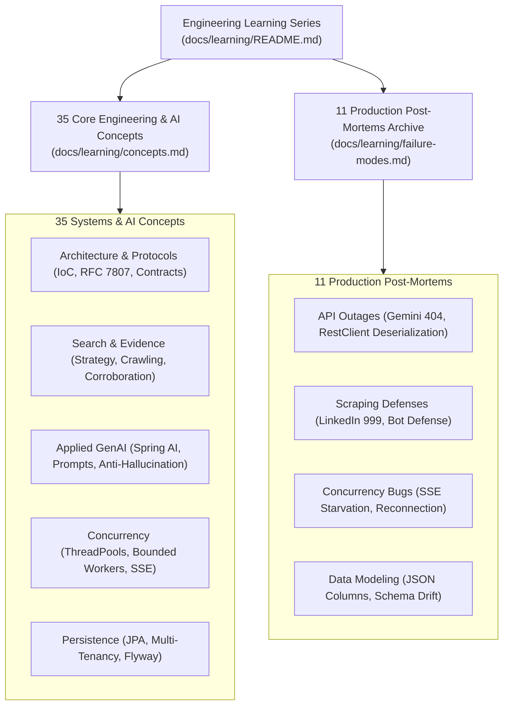

# Engineering Learning Series

Welcome to the **Data Enrichment AI Intelligence Platform** engineering learning curriculum.

This curriculum provides production-grade architectural and implementation guides explaining **why** the platform is engineered the way it is, the trade-offs made, failure modes encountered, and real-world distributed systems patterns.

---

## Table of Contents
- [Curriculum Architecture](#curriculum-architecture)
- [1. 35 Core Engineering & AI Concepts (concepts.md)](#1-35-core-engineering--ai-concepts-conceptsmd)
  - [Domain Breakdown](#domain-breakdown)
- [2. Production Failure Modes & Incident Post-Mortems (failure-modes.md)](#2-production-failure-modes--incident-post-mortems-failure-modesmd)
  - [Incident Taxonomy](#incident-taxonomy)
- [Related Architecture Documentation](#related-architecture-documentation)

---

## Curriculum Architecture

The engineering learning materials are organized into two comprehensive, production-grade deep-dive catalogs:

---

## 1. [35 Core Engineering & AI Concepts](concepts.md)

An exhaustive, 1,300+ line technical compendium analyzing **35 software engineering, distributed systems, and applied AI concepts** implemented across the platform.

Each concept is rigorously dissected across 7 mandatory dimensions:
1. **Core Concept Definition**
2. **Why It Matters in Real Systems**
3. **How This System Implements It** (with concrete Java/TypeScript code snippets and class pointers)
4. **Real Failure Modes & Edge Cases**
5. **Mental Model & ASCII / Mermaid Diagram**
6. **Architectural Trade-offs**
7. **Senior Engineering & Interview Talking Points**

### Domain Breakdown

* **API Protocols & Gateway Ingress**: RFC 7807 problem details, content negotiation, anti-spoofing header normalization, contract-first API evolution, reverse proxy routing.
* **Architecture & Design Patterns**: Inversion of Control, Strategy pattern for search providers, GoF Bridge pattern for event dispatching, strict DTO boundary segregation.
* **Search & Evidence Extraction**: Multi-query expansion, primary source ranking, polite web crawling, SSRF protection, multi-source corroboration, and conflict detection.
* **Applied Generative AI**: Spring AI `ChatModel`, structured JSON output schema enforcement, zero-hallucination verbatim quote grounding, and deterministic heuristic fallback.
* **Concurrency & Observability**: Fixed worker thread pools (`EnrichmentTaskExecutor`), bounded queue backpressure (`CallerRunsPolicy`), Server-Sent Events (SSE) streaming, bounded replay buffers, and distributed MDC correlation tracing.
* **Relational Persistence**: MySQL 8.0, Spring Data JPA, orphan removal, versioned Flyway migrations, and multi-tenant user isolation.

👉 **Read the full catalog**: **[35 Core Engineering & AI Concepts](concepts.md)**

---

## 2. [Production Failure Modes & Incident Post-Mortems](failure-modes.md)

An exhaustive post-mortem archive documenting **11 critical production incidents** encountered, debugged, and architecturally resolved during development and scaling.

Each incident follows the standard Tier-1 engineering post-mortem structure:
1. **Summary & Error Signature**
2. **Root Cause Analysis (RCA)**
3. **Reproducing Scenario & Production Logs**
4. **Engineering Fix Applied** (with before/after code diffs)
5. **Verification & Regression Safeguards** (exact automated test classes)
6. **System Lessons & Senior Engineering Takeaways**

### Incident Taxonomy

| # | Incident Title | Subsystem Impacted | Key Failure Pattern |
| :-: | :--- | :--- | :--- |
| **01** | Gemini Model Name Deprecation & Autoconfiguration | `ai-intelligent-service` | HTTP 404 Model Not Found |
| **02** | Silent HTTP Fallback Dishonesty | `dataset-service` | `COMPLETED` Status Masking AI Outage |
| **03** | Upstream Content-Type & ProblemDetail Parsing Mismatch | `research-service` &rarr; `ai-service` | `RestClient` Deserialization Crash |
| **04** | LinkedIn Bot Defense & HTTP 999 Request Denied | `research-service` | Anti-Scraping 999 Status Code |
| **05** | Search Provider Snippet Fallback & Extraction Provenance | `research-service` | Blocked Fetch Dead-End & Confidence Discount |
| **06** | Single-Query Discovery Starvation vs Multi-Query Expansion | `research-service` | Sparse Input Zero-Source Yield |
| **07** | ResearchDepth Enum Hardcoding & Contract Invariants | `research-service` | Client Query Param Enum Deserialization 400 |
| **08** | SSE Pipeline Event Desynchronization & Thread Starvation | `dataset-service` | SSE Emitter Hang & Worker Starvation |
| **09** | Hallucination vs Grounded Evidence Boundary | `ai-intelligent-service` | LLM Plausible Fabrications |
| **10** | Database Schema Evolution & JSON Column Serialization | `dataset-service` | Relational Entity Schema Rigidness |
| **11** | Docker Compose Gateway Resolution & Timeouts | `api-gateway` & Docker | Container DNS Lookup & Network Timeouts |

👉 **Read the full archive**: **[Production Failure Modes & Post-Mortems](failure-modes.md)**

---

## Related Architecture Documentation

* For high-level system topology, see [System Architecture](../architecture/overview.md).  
* For the end-to-end data lifecycle, see [Enrichment Flow](../architecture/data-flow.md).  
* For API endpoint documentation, see [API Reference](../api/overview.md).  
* For architectural decisions and ADRs, see [Architecture Decisions](../decisions/README.md).
