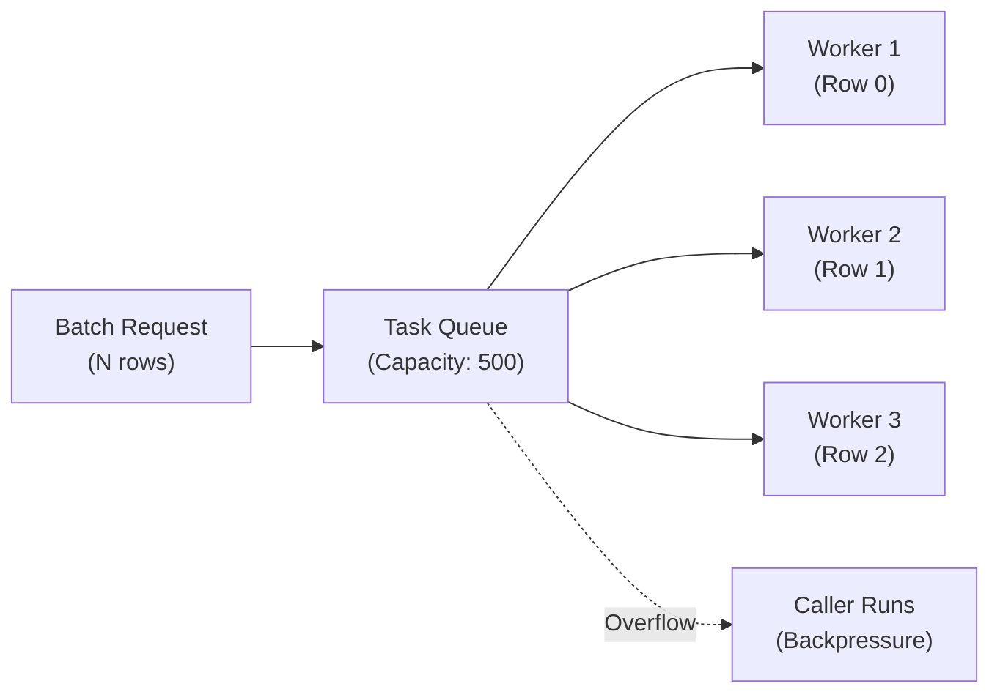
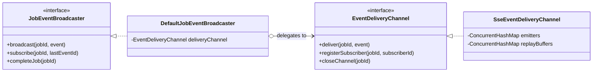

# Dataset Service

The **Dataset Service** (`com.subdual.dataset_service`) is the batch orchestration coordinator, real-time execution observability provider, and relational persistence boundary (MySQL via Spring Data JPA + Flyway) for the platform.

---

## Table of Contents
- [1. Core Responsibilities](#1-core-responsibilities)
- [2. Key Capabilities & Endpoints](#2-key-capabilities--endpoints)
- [3. Simplified 5-Package Architecture](#3-simplified-5-package-architecture)
- [4. Bounded Concurrency (EnrichmentTaskExecutor)](#4-bounded-concurrency-enrichmenttaskexecutor)
- [5. Real-Time Observability & The GoF Bridge Pattern](#5-real-time-observability--the-gof-bridge-pattern)
- [6. Inter-Service Communication & Resilience](#6-inter-service-communication--resilience)
- [7. Relational Data Modeling & Multi-Tenancy](#7-relational-data-modeling--multi-tenancy)

---

## 1. Core Responsibilities

* **Separation of Volatility**: Web crawling and LLM prompting are non-deterministic, high-latency, and failure-prone. This service isolates ACID transactions, entity data models, and query serving from external network volatility.
* **Bounded Parallel Batch Orchestration**: Coordinates multi-row dataset enrichment jobs across a managed `ThreadPoolTaskExecutor` (default: 3 workers) with row-level error isolation.
* **Real-Time Observability**: Streams live worker state transitions, stage badges, and row completion events to the browser using Server-Sent Events (SSE).
* **Idempotent Snapshot Storage**: Allows re-running enrichment jobs on existing entities without duplicating rows or leaving orphan records.
* **User-Scoped Data Ownership**: Enforces tenant boundary isolation—users can only query, subscribe to, or cancel their own batch jobs and entity records.

---

## 2. Key Capabilities & Endpoints

| Method | Path | Description | Public / Auth |
| :--- | :--- | :--- | :--- |
| `POST` | `/api/v2/datasets/upload` | Uploads and parses tabular CSV / XLSX files with delimiter sniffing and malformed row detection. | Auth (JWT) |
| `POST` | `/api/v2/datasets/profile` | Profiles dataset columns, detects semantic roles, identity candidates, and quality score. | Auth (JWT) |
| `POST` | `/api/v1/enrichment/jobs` | Submits a batch dataset enrichment job across rows. | Auth (JWT) |
| `GET` | `/api/v1/enrichment/jobs/{jobId}` | Retrieves job metadata, progress counters, and row statuses. | Auth (JWT) |
| `GET` | `/api/v1/enrichment/jobs/{jobId}/events` | Establishes a Server-Sent Events (SSE) stream for real-time progress. | Auth (JWT) |
| `POST` | `/api/v1/enrichment/jobs/{jobId}/cancel` | Cancels an active or queued batch job. | Auth (JWT) |
| `POST` | `/api/v1/enrichment/single` | Synchronously enriches a single entity row. | Auth (JWT) |
| `POST` | `/api/v1/entities` | Idempotently persists an entity snapshot with sources and attributes. | Internal / Auth |
| `GET` | `/api/v1/entities` | Paginated catalog query of saved entities for the authenticated user. | Auth (JWT) |
| `GET` | `/api/v1/entities/{id}` | Retrieves full entity details, sources, and attribute evidence. | Auth (JWT) |
| `GET` | `/actuator/health` | Service health status probe (`UP`). | Public |

---

## 3. Simplified 5-Package Architecture

The service strictly adheres to a **simplified 5-package architecture** with low coupling and high cohesion:

```
com.subdual.dataset_service
├── DatasetServiceApplication.java
│
├── dataset/                                      # Domain 1: Ingestion, parsing & profiling
│   ├── DatasetIngestionController.java           # POST /api/v2/datasets/upload, /profile
│   ├── DatasetIngestionService.java              # Ingestion contract
│   ├── DefaultDatasetIngestionService.java       # Ingestion orchestrator
│   ├── DatasetParser.java                        # Strategy interface for file parsers
│   ├── DatasetParserFactory.java                 # Parser factory by Content-Type / extension
│   ├── CsvDatasetParser.java                     # RFC 4180 CSV parser with delimiter sniffing
│   ├── ExcelDatasetParser.java                   # Apache POI streaming XLSX parser
│   ├── DatasetProfiler.java                      # Semantic schema profiler
│   ├── DefaultDatasetProfiler.java               # Column role detection & quality scoring
│   ├── ColumnRoleDetector.java                   # Heuristic role classification (Name, URL, etc.)
│   ├── DatasetValidator.java                     # Upload validation & sanity checks
│   ├── dto/ (DatasetProfileRequest, DatasetProfileReport)
│   └── model/ (RawDataset, ColumnProfile, ColumnRole, MalformedRow)
│
├── enrichment/                                   # Domain 2: Batch orchestration & SSE streaming
│   ├── EnrichmentJobController.java              # POST /jobs, GET /jobs/{id}, GET /events
│   ├── DatasetEnrichmentService.java             # Batch enrichment coordinator contract
│   ├── DefaultDatasetEnrichmentService.java      # Job lifecycle & bounded thread coordination
│   ├── EnrichmentEngineFacade.java               # Unified facade interface
│   ├── DefaultEnrichmentEngineFacade.java        # Facade implementation
│   ├── EnrichmentJobManager.java                 # Thread-safe in-memory job state repository
│   ├── EnrichmentTaskExecutor.java               # Bounded ThreadPoolExecutor with CallerRunsPolicy
│   ├── RowEnrichmentProcessor.java               # Individual row research & AI pipeline execution
│   ├── RowIdentityResolver.java                  # Entity identity seed resolver
│   ├── event/                                    # GoF Bridge Pattern for event delivery
│   │   ├── JobEventBroadcaster.java              # Abstraction interface
│   │   ├── DefaultJobEventBroadcaster.java       # Event broadcaster implementation
│   │   ├── EventDeliveryChannel.java             # Implementor interface
│   │   └── SseEventDeliveryChannel.java          # SSE emitter channel with replay buffer
│   ├── client/                                   # Downstream RestClient clients
│   │   ├── ResearchServiceClient.java            # Client to research-service (:9741)
│   │   ├── AiServiceClient.java                  # Client to ai-intelligent-service (:9742)
│   │   └── dto/ (ResearchResultPayload, FactExtractionPayload)
│   ├── dto/ (JobSubmissionRequest, JobStatusResponse, SingleEnrichmentRequest, RowEnrichmentResultResponse)
│   └── model/ (JobState, ResearchFinding, ResearchProfile, ObjectiveAssessment)
│
├── entity/                                       # Domain 3: Relational persistence & entity catalog
│   ├── EntityController.java                     # GET /api/v1/entities, GET /{id}, POST /
│   ├── EntityPersistenceService.java             # Entity snapshot persistence contract
│   ├── DefaultEntityPersistenceService.java      # JPA entity service with orphan removal
│   ├── EnrichedEntityRepository.java             # Spring Data JPA repository
│   ├── EntityIdResolver.java                     # Entity identity resolver
│   ├── EntityMapper.java                         # Entity <-> DTO mapper
│   ├── model/
│   │   ├── EnrichedEntity.java                   # JPA entity with user_id multi-tenancy
│   │   ├── EnrichedSource.java                   # Discovered web source JPA child
│   │   └── EnrichedAttribute.java                # Corroborated attribute JPA child
│   └── dto/ (PersistEntityRequest, EntitySummaryResponse, EntityDetailResponse)
│
├── shared/                                       # Cross-cutting utilities & error handling
│   ├── exception/GlobalExceptionHandler.java     # Central RFC 7807 error handler
│   ├── filter/CorrelationIdFilter.java           # Inbound MDC correlation ID filter
│   ├── interceptor/CorrelationIdClientInterceptor.java # Outbound RestClient tracing interceptor
│   └── model/ApiErrorResponse.java
│
└── configuration/                                # Spring configuration & thread execution beans
    ├── DatasetServiceConfiguration.java          # RestClient, Jackson, and MVC beans
    ├── EnrichmentProperties.java                 # Concurrency & timeout properties
    └── WebSecurityConfiguration.java             # Security & CORS configuration
```

---

## 4. Bounded Concurrency (`EnrichmentTaskExecutor`)

Sequential dataset processing is unacceptably slow, but unbounded thread spawning risks thread starvation, out-of-memory errors, and rate-limiting from external search APIs.

### Managed Executor Architecture
* **Component**: `EnrichmentTaskExecutor` (`com.subdual.dataset_service.enrichment`)
* **Thread Pool**: Managed `ThreadPoolExecutor` with daemon worker threads
* **Core Pool Size / Concurrency**: 3 (configurable via `enrichment.execution.concurrency: 3`)
* **Queue Capacity**: 500 tasks (configurable via `enrichment.execution.queue-capacity: 500`)
* **Thread Name Prefix**: `dataset-enrichment-worker-`
* **Rejection Policy**: `ThreadPoolExecutor.CallerRunsPolicy`



When the 500-item queue fills up, `CallerRunsPolicy` forces the submitting thread to execute the row task directly, throttling new submissions until the worker pool recovers. On application shutdown, `@PreDestroy` executes graceful termination with a 5-second await timeout before escalating to `shutdownNow()`.

---

## 5. Real-Time Observability & The GoF Bridge Pattern

To decouple event generation from delivery protocols, `dataset-service` implements the **GoF Bridge Pattern**:



### In-Memory Replay Buffer
To provide seamless UX during network reconnection or page refreshes, `SseEventDeliveryChannel` maintains an in-memory replay buffer:
* **Capacity**: Last 500 events per job.
* **Storage**: Thread-safe bounded buffer (`ConcurrentLinkedQueue`).
* **Handshake Sequence**:
  1. Client connects to `GET /api/v1/enrichment/jobs/{jobId}/events`.
  2. The service sends an immediate `init` event containing `jobId`, `totalRows`, and active worker concurrency.
  3. Replays all historical buffered events in sequence, allowing the client's `LiveExecutionDashboard` to reconstruct current worker cards immediately.
  4. Keeps the `SseEmitter` open for live event streaming.

---

## 6. Inter-Service Communication & Resilience

The service delegates research and intelligence to downstream microservices using Spring 6's synchronous `RestClient`.

### A. Distributed MDC Tracing (`CorrelationIdClientInterceptor`)
Every HTTP call attaches the `X-Correlation-ID` header. If an MDC trace does not exist, a new UUID is generated and bound. Downstream services (`research-service` and `ai-intelligent-service`) log using this identifier:

```java
@Bean
public RestClient restClient(RestClient.Builder builder, CorrelationIdClientInterceptor interceptor) {
    return builder
            .requestInterceptor(interceptor)
            .build();
}
```

### B. Dependency Resilience & Degradation
* **`ResearchServiceClient` (Hard Dependency)**:
  - Invokes `POST /api/v1/research`.
  - No fallback: Web evidence is mandatory. If `research-service` is unreachable or times out, the row status is set to `FAILED`.
* **`AiServiceClient` (Soft Dependency)**:
  - Invokes `POST /api/v1/ai/requirement`, `/clean`, `/enrich`, `/profile/assess`.
  - Resilient fallback: If the AI service is unreachable or rate-limited, raw research tuples are extracted directly without LLM transformation, and the row status is marked `AI_DEGRADED`.

---

## 7. Relational Data Modeling & Multi-Tenancy

Persistence uses MySQL 8.0, Spring Data JPA, and Flyway versioned migrations (`classpath:db/migration`).

### Multi-Tenant Boundary Isolation
Every entity record (`EnrichedEntity`) is tied to the authenticated user's `userId` (`X-User-Id` injected securely by `api-gateway`). All JPA repository queries enforce `WHERE user_id = :userId` to prevent Insecure Direct Object Reference (IDOR) attacks.
