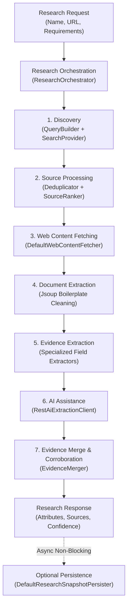
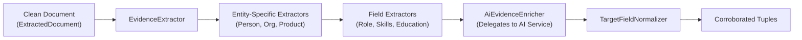

# Research Service

The **Research Service** (`com.subdual.research_service`) coordinates autonomous web discovery, content fetching, boilerplate cleaning, verbatim evidence compilation, and multi-source corroboration for target entities.

---

## Table of Contents
- [1. Core Responsibilities](#1-core-responsibilities)
- [2. Key Capabilities & Endpoints](#2-key-capabilities--endpoints)
- [3. High-Level Research Pipeline](#3-high-level-research-pipeline)
- [4. Simplified 5-Package Architecture](#4-simplified-5-package-architecture)
- [5. Requirement-Aware Query Construction (QueryBuilder)](#5-requirement-aware-query-construction-querybuilder)
- [6. Defensive Web Crawling & SSRF Protection](#6-defensive-web-crawling--ssrf-protection)
- [7. Evidence Extraction & Normalization](#7-evidence-extraction--normalization)
- [8. Multi-Source Corroboration Engine (EvidenceMerger)](#8-multi-source-corroboration-engine-evidencemerger)

---

## 1. Core Responsibilities

* **Core Principle**: *"Research produces evidence."*
* **Autonomous Exploration**: LLMs cannot browse the web directly. This service treats input names and URLs as research seeds, formulates requirement-aware search queries, fetches web pages, and compiles factual evidence before triggering AI extraction.
* **Provider Decoupling**: Abstracts web search behind the `SearchProvider` interface (Tavily search provider with offline `MockSearchProvider` fallback).
* **Defensive Web Crawling**: Enforces strict timeouts, buffer caps, and anti-bot degradation fallbacks (falling back to search engine snippets when direct scraping is blocked).
* **Multi-Source Corroboration**: Evaluates claims across multiple sources, boosts confidence when independent domains agree, and flags conflicting information.

---

## 2. Key Capabilities & Endpoints

| Method | Path | Description | Public / Auth |
| :--- | :--- | :--- | :--- |
| `POST` | `/api/v1/research` | Executes synchronous end-to-end research for an entity. | Internal / Auth |
| `POST` | `/api/v1/research/jobs` | Submits an asynchronous background research job. | Internal / Auth |
| `GET` | `/api/v1/research/jobs/{jobId}` | Polls the status and result of an asynchronous research job. | Internal / Auth |
| `GET` | `/actuator/health` | Service health status probe (`UP`). | Public |

---

## 3. High-Level Research Pipeline



---

## 4. Simplified 5-Package Architecture

The service strictly adheres to a **simplified 5-package architecture** with low coupling and high cohesion:

```
com.subdual.research_service
├── ResearchServiceApplication.java
│
├── api/                                          # Public REST boundary
│   ├── ResearchController.java                   # POST /api/v1/research, POST /jobs, GET /jobs/{id}
│   ├── ResearchRequestValidator.java             # Request validation & constraint checks
│   └── dto/
│       ├── ResearchRequest.java                  # Inbound research command
│       └── response/
│           ├── ResearchResponse.java             # Full synchronous research result
│           ├── ResearchResult.java               # Corroborated entity snapshot
│           ├── ResearchJobResponse.java          # Asynchronous job poll response
│           ├── EvidenceTuple.java                # Fact attribute with quote and confidence
│           └── SourceItem.java                   # Discovered web source metadata
│
├── research/                                     # Core research domain & orchestration
│   ├── ResearchService.java                      # Research orchestrator contract
│   ├── ResearchOrchestrator.java                 # Pipeline coordination & execution engine
│   ├── discovery/                                # Web search, query building & source ranking
│   │   ├── ResearchDiscoveryService.java         # Discovery contract
│   │   ├── DefaultResearchDiscoveryService.java  # Discovery implementation
│   │   ├── QueryBuilder.java                     # Contextual, requirement-aware search queries
│   │   ├── provider/SearchProvider.java          # Search strategy interface (Tavily, Mock)
│   │   ├── ranking/SourceRanker.java             # Domain authority & relevance ranker
│   │   └── ranking/SourceDeduplicator.java       # URL & domain deduplicator
│   ├── evidence/                                 # HTML document cleaning & evidence extraction
│   │   ├── SourceEvidenceService.java            # Evidence extraction contract
│   │   ├── DefaultSourceEvidenceService.java     # Document parsing & field extraction orchestrator
│   │   ├── AiEvidenceEnricher.java               # Delegates extraction to AI service
│   │   ├── document/ContentExtractor.java        # Jsoup DOM cleaner & text extractor
│   │   ├── extractor/EvidenceExtractor.java      # Extractor strategy interface
│   │   ├── extractor/field/                      # Specialized field extractors
│   │   └── corroboration/EvidenceMerger.java     # Multi-source corroboration & confidence scoring
│   ├── crawler/DefaultWebContentFetcher.java     # Defensive web crawler with size & timeout bounds
│   └── job/ResearchJobService.java               # In-memory async job state manager
│
├── integration/                                  # Downstream inter-service clients
│   ├── ai/RestAiExtractionClient.java            # RestClient to ai-intelligent-service (:9742)
│   └── persistence/DefaultResearchSnapshotPersister.java # RestClient to dataset-service (:9743)
│
├── shared/                                       # Cross-cutting utilities & normalizers
│   ├── exception/GlobalExceptionHandler.java     # RFC 7807 problem details handler
│   ├── security/SecurityValidator.java           # SSRF protection validator
│   ├── normalization/UrlNormalizer.java          # Canonical URL & tracking parameter stripper
│   └── filter/CorrelationIdFilter.java           # Inbound MDC correlation ID filter
│
└── configuration/                                # Spring configuration properties
    ├── ResearchProperties.java                   # Search provider, crawler, and timeout flags
    └── WebClientConfiguration.java               # RestClient, timeout, and buffer beans
```

---

## 5. Requirement-Aware Query Construction (`QueryBuilder`)

A naive search for an entity name (e.g. `"John Smith"`) returns noisy, irrelevant search results. `QueryBuilder` formulates multi-strategy, context-aware queries:

### Query Strategies
1. **Primary Canonical Query**: Combines entity name with anchor profile domain (e.g. `site:linkedin.com/in/ "Linus Torvalds"`).
2. **Contextual Disambiguation**: When an anchor URL is missing, anchors the entity using known organization, location, or professional role (e.g. `"Guido van Rossum" Microsoft "Distinguished Engineer"`).
3. **Requirement-Specific Query**: Maps user requirements into targeted keyword queries (e.g. `"Satya Nadella" Microsoft education university degree`).
4. **Adaptive Gap Closing**: If initial discovery leaves critical fields missing, `discoverAdaptiveSources()` builds targeted secondary queries to fill specific information gaps.

---

## 6. Defensive Web Crawling & SSRF Protection

Web crawling untrusted URLs poses severe operational and security risks:
* **Server-Side Request Forgery (SSRF)**: `SecurityValidator` validates destination hosts against private IP ranges (`127.0.0.1`, `10.0.0.0/8`, `192.168.0.0/16`, AWS/GCP metadata endpoints).
* **Connection & Read Timeouts**: Strictly caps socket connection and read operations at **5,000ms**.
* **Buffer Limiting**: Enforces a **500KB content limit**. Excess bytes are discarded to prevent memory exhaustion from oversized downloads.
* **Anti-Bot Snippet Fallback**: If target sites return anti-bot status codes (HTTP 403, 429, or Cloudflare HTTP 999), the fetcher gracefully degrades by extracting evidence from the search provider's index snippet rather than failing.

---

## 7. Evidence Extraction & Normalization

Evidence collection combines rule-based extractors with AI assistance:



### Specialized Field Extractors (`research/evidence/extractor/field/`)
* **`RoleFieldExtractor`**: Detects professional headlines and titles.
* **`OrganizationFieldExtractor`**: Identifies employers, subsidiaries, and corporate entities.
* **`EducationFieldExtractor`**: Identifies universities, degrees, and graduation years.
* **`TechFieldExtractor` & `SkillFieldExtractor`**: Identifies programming languages, cloud platforms, and frameworks.

---

## 8. Multi-Source Corroboration Engine (`EvidenceMerger`)

When multiple sources provide claims about the same attribute, `EvidenceMerger` evaluates provenance:

### Confidence Tier Elevation
1. **Single Source**: If only one domain makes a claim, the attribute is assigned `LOW` confidence (or `MEDIUM` if from an authoritative primary domain).
2. **Independent Corroboration**: If two or more independent second-level domains agree on the same value, confidence is boosted to `HIGH`.
3. **Conflict Detection**: If independent sources state conflicting values (e.g. Source A says `"VP Engineering"` while Source B says `"Chief Technology Officer"`):
   - Sets `conflictDetected = true`.
   - Records all conflicting claims and corroborating URLs in an audit trail.
   - Assigns priority to the primary authoritative domain.
