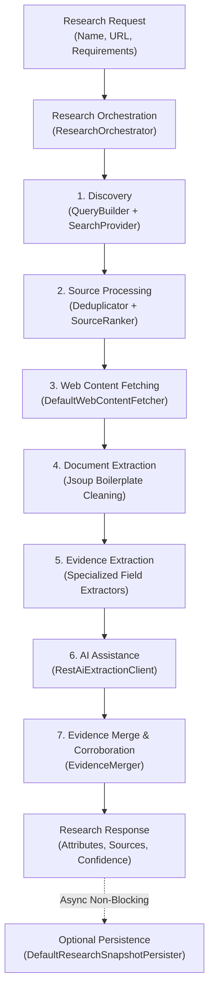

# Research Service

The **Research Service** (`com.subdual.research_service`) coordinates autonomous web discovery, content fetching, boilerplate cleaning, verbatim evidence compilation, and multi-source corroboration for target entities.

---

## 1. Core Responsibilities

* **Core Principle**: *"Research produces evidence."*
* **Autonomous Exploration**: LLMs cannot browse the web directly. This service treats input names and URLs as research seeds, formulates requirement-aware search queries, fetches web pages, and compiles factual evidence before triggering AI extraction.
* **Provider Decoupling**: Abstracts web search behind the `SearchProvider` interface (Tavily search provider with offline `MockSearchProvider` fallback).
* **Defensive Web Crawling**: Enforces strict timeouts, buffer caps, and anti-bot degradation fallbacks (falling back to search engine snippets when direct scraping is blocked).
* **Multi-Source Corroboration**: Evaluates claims across multiple sources, boosts confidence when independent domains agree, and flags conflicting information.

---

## 2. Key Capabilities & Endpoints

| Method | Path | Description | Public / Auth |
| :--- | :--- | :--- | :--- |
| `POST` | `/api/v1/research` | Executes synchronous end-to-end research for an entity. | Internal / Auth |
| `POST` | `/api/v1/research/jobs` | Submits an asynchronous background research job. | Internal / Auth |
| `GET` | `/api/v1/research/jobs/{jobId}` | Polls the status and result of an asynchronous research job. | Internal / Auth |
| `GET` | `/actuator/health` | Service health status probe (`UP`). | Public |

---

## 3. High-Level Research Pipeline



---

### 4. Package Organization

The service strictly adheres to a **simplified 5-package architecture** with low coupling and high cohesion:

```
com.subdual.research_service
├── ResearchServiceApplication.java
│
├── api/                                          # Public REST boundary
│   ├── ResearchController.java                   # POST /api/v1/research, POST /jobs, GET /jobs/{id}
│   ├── ResearchRequestValidator.java             # Request validation & constraint checks
│   └── dto/
│       ├── ResearchRequest.java                  # Inbound research command
│       └── response/
│           ├── ResearchResponse.java             # Full synchronous research result
│           ├── ResearchResult.java               # Corroborated entity snapshot
│           ├── ResearchJobResponse.java          # Asynchronous job poll response
│           ├── EvidenceTuple.java                # Fact attribute with quote and confidence
│           └── SourceItem.java                   # Discovered web source metadata
│
├── research/                                     # Core research domain & orchestration
│   ├── ResearchService.java                      # Research orchestrator contract
│   ├── ResearchOrchestrator.java                 # Pipeline coordination & execution engine
│   ├── discovery/                                # Web search, query building & source ranking
│   │   ├── ResearchDiscoveryService.java         # Discovery contract
│   │   ├── DefaultResearchDiscoveryService.java  # Discovery implementation
│   │   ├── QueryBuilder.java                     # Contextual, requirement-aware search queries
│   │   ├── provider/                             # Search provider implementations
│   │   │   ├── SearchProvider.java               # Search strategy interface
│   │   │   ├── TavilySearchProvider.java         # Live Tavily API search provider
│   │   │   ├── MockSearchProvider.java           # Offline deterministic fallback provider
│   │   │   ├── ResearchProvider.java             # Provider metadata interface
│   │   │   └── ResilientSearchProviderDecorator.java # Resilience wrapper with timeout & error handling
│   │   ├── factory/                              # Search provider factories
│   │   │   ├── SearchProviderFactory.java        # Factory interface
│   │   │   └── DefaultSearchProviderFactory.java # Live vs mock provider factory
│   │   ├── ranking/                              # Source scoring & deduplication
│   │   │   ├── SourceRanker.java                 # Domain authority & relevance ranker
│   │   │   ├── SourceDeduplicator.java           # URL & domain deduplicator
│   │   │   └── SourceTypeClassifier.java         # Primary vs secondary classifier
│   │   ├── cache/ThreadSafeSourceCache.java      # Discovered source cache
│   │   └── model/ (ResearchQuery, QueryIntent, QueryStrategy, DiscoveryMetrics)
│   ├── evidence/                                 # HTML document cleaning & evidence extraction
│   │   ├── SourceEvidenceService.java            # Evidence extraction contract
│   │   ├── DefaultSourceEvidenceService.java     # Document parsing & field extraction orchestrator
│   │   ├── AiEvidenceEnricher.java               # Delegates extraction to AI service
│   │   ├── document/                             # HTML boilerplate removal
│   │   │   ├── ContentExtractor.java             # Jsoup DOM cleaner & text extractor
│   │   │   └── ExtractedDocument.java            # Clean document model
│   │   ├── extractor/                            # Entity & field extractors
│   │   │   ├── EvidenceExtractor.java            # Extractor strategy interface
│   │   │   ├── CommonEvidenceExtractor.java      # Base extractor implementation
│   │   │   ├── PersonEvidenceExtractor.java      # Person-specific extraction
│   │   │   ├── OrganizationEvidenceExtractor.java # Organization-specific extraction
│   │   │   ├── ProductEvidenceExtractor.java     # Product-specific extraction
│   │   │   ├── RepositoryEvidenceExtractor.java  # Code repo-specific extraction
│   │   │   └── field/                            # Field extractors (Role, Org, Skill, Tech, Education, etc.)
│   │   ├── factory/                              # Extractor factories
│   │   │   ├── EntityEvidenceExtractor.java      # Extractor contract
│   │   │   ├── EntityEvidenceExtractorFactory.java # Factory interface
│   │   │   └── DefaultEntityEvidenceExtractorFactory.java # Strategy selector
│   │   └── support/                              # Normalizers, merger & corroboration
│   │       ├── EvidenceMerger.java               # Multi-source corroboration & conflict resolution
│   │       ├── EntityResolver.java               # Entity matching & disambiguation
│   │       ├── FuzzyMatcher.java                 # String similarity matching
│   │       ├── NameNormalizer.java               # Person name normalization
│   │       ├── OrganizationNormalizer.java       # Company name normalization
│   │       ├── TargetFieldNormalizer.java        # Canonical field key normalizer
│   │       └── EvidenceQuality.java              # Direct crawl vs snippet quality tier
│   ├── factory/                                  # Component lifecycle factories
│   │   ├── ResearchComponentFactory.java         # Component factory interface
│   │   ├── LiveResearchComponentFactory.java     # Live HTTP component wiring
│   │   ├── OfflineResearchComponentFactory.java  # Offline mock component wiring
│   │   └── ResearchComponentFactoryProvider.java # Provider selector based on active profile
│   ├── job/                                      # Asynchronous background job management
│   │   ├── ResearchJobService.java               # Job management contract
│   │   ├── InMemoryResearchJobService.java       # Thread-safe in-memory job tracker
│   │   ├── ResearchJob.java                      # Job entity model
│   │   └── ResearchJobStatus.java                # Job status enum (PENDING, RUNNING, COMPLETED, FAILED)
│   ├── model/ (ResearchTarget, ResearchSource, DiscoveredSource, ConfidenceTier, EntityType, etc.)
│   └── pipeline/ (ResearchContext, ResearchDiagnostics, RelevanceEvaluator, SourceProcessor, etc.)
│
├── integration/                                  # External client boundaries
│   ├── ai/                                       # Client to ai-intelligent-service (:9742)
│   │   ├── AiExtractionClient.java               # Extraction client interface
│   │   ├── RestAiExtractionClient.java           # Spring RestClient implementation
│   │   ├── NoOpAiExtractionClient.java           # Offline mock client
│   │   └── dto/ (AiExtractionRequest, AiExtractionResponse, AiExtractedFact)
│   ├── dataset/                                  # Client to dataset-service (:9743)
│   │   ├── DatasetPersistenceClient.java         # Persistence client interface
│   │   ├── RestDatasetPersistenceClient.java     # Spring RestClient implementation
│   │   ├── NoOpDatasetPersistenceClient.java     # Offline mock client
│   │   └── dto/ (PersistEntityRequest, EntityAttributeDto, EntitySourceDto)
│   ├── persistence/                              # Non-blocking entity persistence
│   │   ├── ResearchSnapshotPersister.java        # Async persister interface
│   │   └── DefaultResearchSnapshotPersister.java # CompletableFuture-based async persister
│   └── web/                                      # Web scraping & HTML fetching
│       ├── WebContentFetcher.java                # Fetcher interface
│       ├── DefaultWebContentFetcher.java         # Jsoup/HttpURLConnection fetcher with timeouts & caps
│       ├── CachingWebContentFetcher.java         # In-memory LRU fetcher cache
│       └── FetchedContent.java                   # Raw HTML & status model
│
├── shared/                                       # Cross-cutting error handling & utilities
│   ├── exception/
│   │   ├── GlobalExceptionHandler.java           # RFC 7807 problem details handler
│   │   ├── BusinessRuleException.java            # Domain rule validation exception
│   │   └── ExternalServiceException.java         # Downstream HTTP client failure exception
│   ├── util/
│   │   └── UrlNormalizer.java                    # Canonical URL normalizer & link unwrapper
│   └── web/
│       └── CorrelationIdFilter.java              # Inbound MDC correlation ID filter
│
└── configuration/                                # Spring @Configuration & properties
    ├── ServiceMeshProperties.java                # Downstream service URLs & timeouts
    ├── WebFetchProperties.java                   # Fetch timeouts, buffer limits & user-agent
    └── WebCorsConfiguration.java                 # CORS configuration
```

For detailed algorithmic flows (including `QueryBuilder` strategies, crawler defenses, and corroboration logic), see **[Research Service Internals](internals.md)**.
